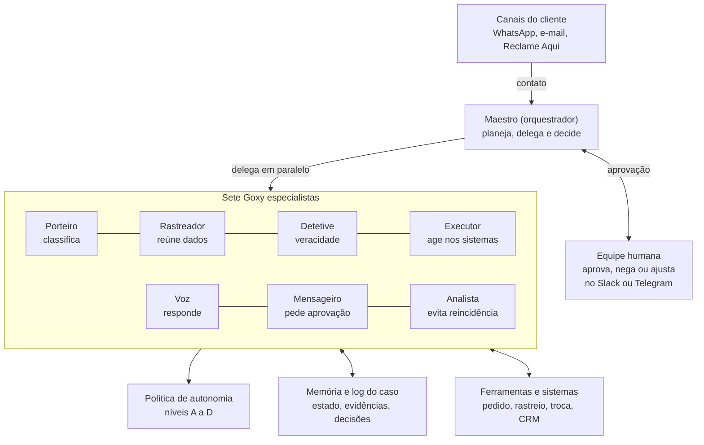
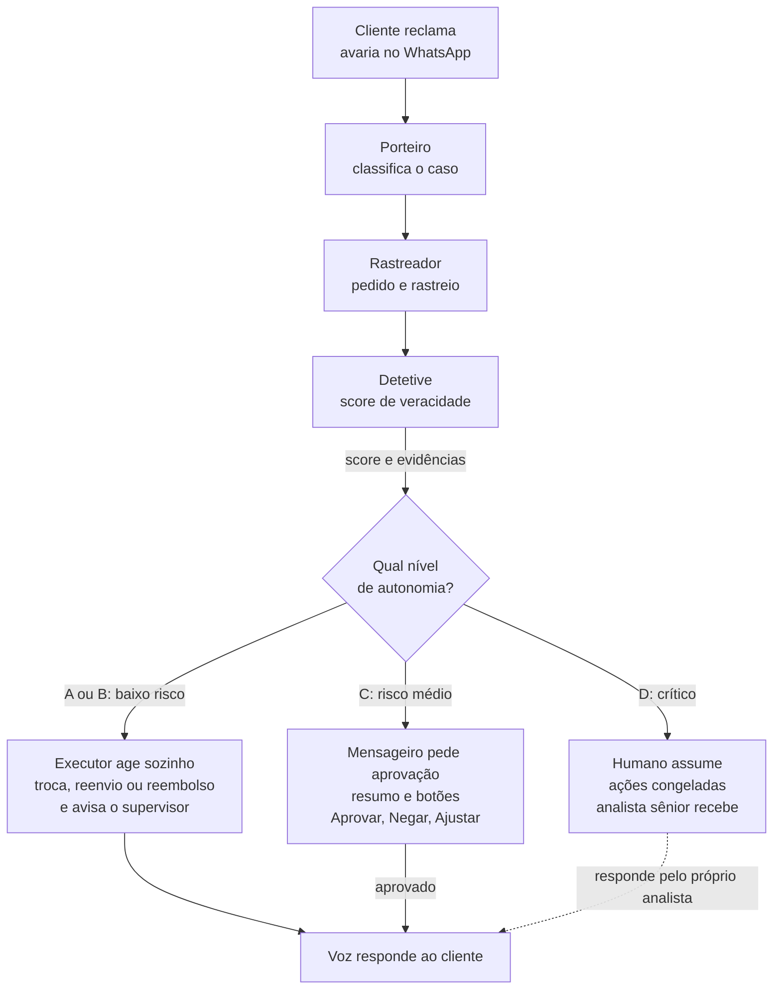
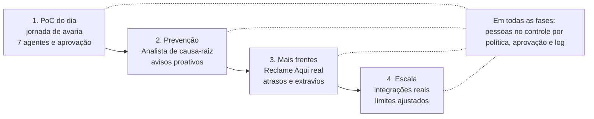

# SPEC: Goxy, agentes de atendimento ao cliente

Hackathon GoHacks Talent · Desafio 1, Atendimento ao Cliente · 7 de novembro de 2026

## 1. Visão geral

O Goxy é uma equipe de agentes de IA, cada um chamado de Goxy, que assume o atendimento de um e-commerce de ponta a ponta: lê o contato, investiga nos sistemas, decide, age e responde ao cliente, chamando uma pessoa só quando o caso exige julgamento humano.

**Problema (Desafio 1, Atendimento ao Cliente).** Milhares de contatos por mês chegam por WhatsApp, e-mail e Reclame Aqui. Resolver um contato exige passar por pedido, transportadora, chamados, troca e reenvio, e parte das reclamações (como avaria que não ocorreu) não procede. Hoje isso é feito à mão.

**Público.** Quem usa: o time de atendimento (supervisores e analistas) e, indiretamente, o cliente final. A necessidade real: reduzir tempo por contato, evitar fraude e eliminar o retrabalho entre sistemas.

**Proposta de valor.** Um colega de trabalho digital que:

- entende a fila do dia e prioriza sozinho;
- age nos sistemas (abre chamado, gera troca, reenvia), não apenas sugere;
- sabe levantar a mão, com pedido de aprovação direto no Slack ou Telegram;
- trabalha em equipe: um orquestrador coordena agentes especialistas;
- aprende com os contatos repetidos para evitar que voltem.

## 2. Inovação: o que torna o Goxy diferente

O diferencial não é responder melhor, e sim decidir e agir com segurança. Cinco ideias sustentam a complexidade da solução:

1. **Orquestração hierárquica.** Um orquestrador planeja o caso como um grafo de tarefas e delega a agentes especialistas, em paralelo quando possível, em vez de um único prompt gigante.
2. **Agente de veracidade (Detetive).** Antes de pagar uma troca, cruza foto, histórico do cliente, rastreio e padrão de reclamações para estimar se a avaria procede. Gera um score com evidências explicáveis.
3. **Autonomia calibrada.** Cada ação tem um nível de risco. O sistema combina valor, confiança do agente e histórico do cliente para decidir entre agir, agir e avisar, ou pedir aprovação.
4. **Humano no loop, no canal onde ele já está.** O pedido de aprovação chega no Slack ou Telegram com contexto resumido e botões Aprovar, Negar ou Ajustar. A decisão volta para o fluxo e o agente continua.
5. **Ciclo de prevenção.** Um agente de causa-raiz agrupa contatos repetidos (ex.: transportadora X atrasa na região Y) e propõe ou executa ações preventivas, como avisar clientes proativamente.

**Fora de escopo por desenho:** chatbot de perguntas e respostas, consulta a base de documentos, automação de passo único e painel que só mostra dados.

## 3. Arquitetura de orquestração



O Maestro recebe o contato, delega aos agentes especialistas (em paralelo quando possível) e consulta a política de autonomia antes de qualquer ação de escrita; só então o Mensageiro aciona uma pessoa.

## 4. Catálogo de agentes

Sete Goxy especialistas e um orquestrador, que juntos formam o Goxy. Cada um tem uma responsabilidade única, ferramentas próprias e uma regra clara de quando levantar a mão.

| Agente | Responsabilidade | Entrada → Saída | Ferramentas | Escala para humano quando |
| --- | --- | --- | --- | --- |
| Orquestrador (Maestro) | Planeja o caso, delega, junta resultados, decide o próximo passo | Contato normalizado → plano e decisão final | Registro de agentes, memória do caso, política de autonomia | Confiança global baixa ou conflito entre agentes |
| Triagem (Porteiro) | Classifica intenção, urgência, sentimento e idioma; detecta duplicata | Mensagem bruta → ticket estruturado | Leitura de canais, busca de cliente | Ameaça jurídica, imprensa, menor de idade |
| Investigação (Rastreador) | Reúne pedido, pagamento, rastreio e histórico entre sistemas | ID do ticket → dossiê do caso | Consulta de pedido, portal da transportadora, CRM | Dado inconsistente entre sistemas |
| Veracidade (Detetive) | Avalia se a reclamação procede, com evidências | Dossiê + fotos → score e justificativa | Análise de imagem, regras antifraude, histórico | Score em faixa cinzenta (ex.: 40 a 70) |
| Resolução (Executor) | Executa a ação: troca, reenvio, reembolso, chamado | Decisão → ação concluída e comprovante | Escrita em pedido, chamados, logística reversa | Valor acima do limite ou ação irreversível |
| Comunicação (Voz) | Redige e envia a resposta no canal de origem, com tom da marca | Resultado → mensagem ao cliente | Envio WhatsApp, e-mail, resposta Reclame Aqui | Cliente muito irritado ou caso público sensível |
| Escalonamento (Mensageiro) | Monta o pedido de aprovação com contexto e botões | Caso pendente → decisão humana | Slack, Telegram, fila de aprovação | Ninguém responde no SLA: reencaminha ao supervisor |
| Causa-raiz (Analista) | Agrupa contatos repetidos e propõe prevenção | Histórico de tickets → insights e ações | Clustering, séries por transportadora e SKU | Ação preventiva com impacto financeiro |

## 5. Fluxo ponta a ponta: produto avariado



O Detetive entrega um score com evidências e o Maestro escolhe entre agir sozinho (níveis A e B), pedir aprovação (C) ou passar o caso a uma pessoa (D). Em todos os caminhos o cliente recebe uma resposta no canal de origem.

## 6. Política de autonomia e escalonamento humano

O Maestro decide o nível de autonomia de cada ação com três sinais: valor envolvido, score de confiança dos agentes e risco do cliente (histórico de fraude ou reincidência). Os limites abaixo são valores iniciais fictícios, editáveis em um arquivo de configuração.

| Nível | Condição (exemplo) | Comportamento | Exemplo |
| --- | --- | --- | --- |
| A. Autônomo | Valor até R$ 150, veracidade acima de 80, cliente sem alerta | Executa e responde sozinho; registra no log | Reenvio de item barato com avaria comprovada por foto |
| B. Autônomo com aviso | Valor de R$ 150 a R$ 500, veracidade acima de 70 | Executa e notifica o supervisor no canal, com opção de desfazer em 15 min | Troca de produto médio |
| C. Aprovação obrigatória | Valor acima de R$ 500, veracidade de 40 a 70, ou ação irreversível | Pausa o caso, envia pedido de aprovação com resumo e botões | Reembolso alto com foto duvidosa |
| D. Humano assume | Veracidade abaixo de 40 com padrão de fraude, ameaça jurídica, imprensa | Congela ações, abre caso para analista sênior | Reclamação com ameaça de processo |

**Regras transversais**

- Toda decisão guarda justificativa, evidências e versão da política aplicada (auditável).
- O agente nunca inventa dado: se faltar informação, pede ao cliente ou escala.
- Se a aprovação não chegar no SLA (ex.: 30 min), o caso sobe ao supervisor e o cliente recebe uma atualização de status.
- Cada decisão humana vira exemplo de aprendizado para ajustar os limites.

## 7. Integrações e ferramentas

Todo acesso a sistemas passa por ferramentas com contrato tipado (entrada e saída em JSON). Na prova de conceito, os sistemas são simulados por uma API fictícia com os mesmos contratos de um sistema real; trocar por dados reais exige só mudar o endereço e a autenticação.

| Ferramenta | Tipo | Contrato resumido | Usada por |
| --- | --- | --- | --- |
| `get_order(order_id)` | Leitura | Retorna itens, valor, status, datas e pagamento | Rastreador |
| `get_tracking(order_id)` | Leitura | Retorna eventos de entrega e transportadora | Rastreador |
| `get_customer_history(customer_id)` | Leitura | Retorna pedidos, reclamações e trocas anteriores | Rastreador, Detetive |
| `analyze_damage_photo(image)` | Leitura | Retorna avaria detectada, confiança e indícios de reuso da foto | Detetive |
| `open_carrier_ticket(order_id, motivo)` | Escrita | Abre chamado e devolve protocolo | Executor |
| `create_exchange(order_id, item)` | Escrita | Gera troca ou reenvio e devolve novo pedido | Executor |
| `issue_refund(order_id, valor)` | Escrita crítica | Reembolsa; exige nível de autonomia permitido | Executor |
| `send_message(canal, cliente, texto)` | Escrita | Envia no WhatsApp, e-mail ou Reclame Aqui (simulado) | Voz |
| `request_approval(caso, opções)` | Humano | Publica no Slack ou Telegram e aguarda decisão | Mensageiro |

**Canais de conversa.** Slack (equipe interna, aprovações) e Telegram ou WhatsApp simulado (cliente). Ambos usam webhooks, então o agente recebe pedidos e envia avisos pelo mesmo lugar onde o time já conversa.

**Segurança das ferramentas.** Chaves ficam em variáveis de ambiente, ferramentas de escrita são registradas em log com quem pediu, e o Executor só chama ferramenta de escrita depois de passar pela política de autonomia.

## 8. Modelo de dados fictício

A pasta de bases (CSV) do evento é o ponto de partida. Se faltar algo, gere dados próprios com este esquema mínimo, incluindo casos de borda para a demo.

| Tabela | Campos principais |
| --- | --- |
| customers | customer_id, nome, canal_preferido, qtd_reclamacoes_90d, flag_risco |
| orders | order_id, customer_id, itens, valor_total, status, data_pedido, data_entrega_prevista |
| shipments | order_id, transportadora, codigo_rastreio, eventos, data_entrega_real |
| tickets | ticket_id, canal, mensagem, intencao, urgencia, status, criado_em |
| claims | ticket_id, tipo (avaria, atraso, extravio), foto_url, score_veracidade, decisao |
| actions_log | acao_id, ticket_id, agente, ferramenta, parametros, resultado, nivel_autonomia |
| approvals | aprovacao_id, ticket_id, solicitante, aprovador, decisao, tempo_resposta |

**Casos para a demo (escolha 5):**

1. Avaria legítima de baixo valor: resolve sozinho (nível A).
2. Avaria com foto reaproveitada de outro pedido: Detetive rejeita e explica.
3. Atraso causado por transportadora: abre chamado e avisa o cliente.
4. Reembolso alto com foto duvidosa: pede aprovação no Slack (nível C).
5. Cliente ameaça processo e cita Reclame Aqui: humano assume (nível D).

## 9. Interface bonita e simples

A interface é uma tela principal com três áreas que mostram o trabalho dos agentes ao vivo, sem painéis supérfluos.

```
┌────────────────────────────────────────────────────────────────────────┐
│ Goxy                                        atualizado em tempo real  │
├──────────────────┬─────────────────────────────┬───────────────────────┤
│ Fila de contatos │ Caso em andamento           │ Aprovações            │
│                  │                             │                       │
│ ▸ Avaria         │ "o produto chegou quebrado" │ Reembolso alto        │
│   Telegram    ●  │                             │ foto duvidosa         │
│                  │ Linha do tempo dos agentes  │ espera uma decisão    │
│   Atraso         │  ✓ Porteiro   classificou   │                       │
│   e-mail      ✓  │  ✓ Rastreador pedido ok     │  [ Aprovar ]          │
│                  │  ✓ Detetive   foto inédita  │  [ Negar   ]          │
│   Reembolso      │  ✓ Executor   troca gerada  │  [ Ajustar ]          │
│   alto        ⏳ │  ◌ Voz        respondendo   │                       │
│                  │                             │ a decisão volta       │
│   Ameaça      ✕  │ cada passo guarda evidência │ ao fluxo              │
└──────────────────┴─────────────────────────────┴───────────────────────┘
```

À esquerda a fila, no centro o caso aberto com a linha do tempo dos agentes e à direita as aprovações pendentes.

**Princípios visuais**

- **Uma ideia por área:** fila, caso ao vivo e aprovações. Tudo o mais fica a um clique.
- **Linha do tempo viva:** cada agente acende quando começa, ganha um check quando termina e abre a evidência ao clique.
- **Cores com significado:** verde para concluído, âmbar para aguardando, vermelho para crítico e um único acento para o que está acontecendo agora.
- **Respiro e tipografia clara:** cantos arredondados, poucos bordos, texto grande, modo claro e escuro.
- **Aprovar em um toque:** os mesmos botões aparecem no Slack, no Telegram e na tela.
- **Linguagem humana:** nomes como Porteiro e Detetive tornam a demo fácil de contar em poucos minutos.

**Telas**

| Tela | Para quê | Elementos principais |
| --- | --- | --- |
| Fila e caso ao vivo | Acompanhar o trabalho dos agentes | Fila com status, mensagem do cliente, linha do tempo |
| Aprovações | Decidir com contexto | Resumo do caso, evidências, botões Aprovar, Negar e Ajustar |
| Detalhe da decisão (gaveta lateral) | Auditar | Evidências, nível de autonomia aplicado, log de ferramentas |
| Visão 360 | Mostrar o impacto | Resolução autônoma, tempo médio, fraude evitada, contatos repetidos evitados |
| Simulador de contatos | Operar a demo | Botões que disparam os 5 casos de teste |

## 10. Stack técnica sugerida

A stack prioriza velocidade de entrega em um dia, com a orquestração clara para a banca. Os nomes são sugestões, não obrigações.

| Camada | Sugestão | Motivo |
| --- | --- | --- |
| Modelo de IA | Claude via o token IA proxy do evento | Raciocínio, uso de ferramentas e visão para fotos |
| Orquestração | Python com Claude Agent SDK, LangGraph ou código próprio de grafo de tarefas | Estado explícito, execução paralela, pausas para aprovação |
| Backend | FastAPI com fila simples (asyncio ou Redis) | Webhooks dos canais e eventos em tempo real |
| Sistemas simulados | API fictícia em FastAPI sobre SQLite ou os CSVs | Contratos iguais aos de um sistema real |
| Canais | Slack (Bolt) e Telegram (bot API) | Aprovação e avisos onde o time já conversa |
| Interface | React, Vite e Tailwind, com Server-Sent Events para tempo real | Interface leve e viva |
| Observabilidade | Log estruturado de cada passo e decisão | Alimenta a linha do tempo da interface e o relatório |

**Estrutura do projeto**

```
goxys/
  agents/        # maestro, porteiro, rastreador, detetive, executor, voz, mensageiro, analista
  tools/         # contratos tipados de cada ferramenta
  policy/        # limites de autonomia (YAML)
  mock_api/      # sistemas e transportadoras simulados
  channels/      # slack.py, telegram.py
  web/           # interface React
  data/          # CSVs e casos de demo
```

## 11. Prova de conceito do dia

A PoC prova uma jornada completa, "produto avariado", com todos os agentes principais e pelo menos um pedido de aprovação humana. O restante da visão fica no roadmap.

**Dentro do escopo**

- Entrada de contato por Telegram (ou WhatsApp simulado) e pela interface.
- Maestro, Porteiro, Rastreador, Detetive, Executor, Voz e Mensageiro funcionando de ponta a ponta.
- Política de autonomia com os níveis A, B, C e D.
- Aprovação por Slack ou Telegram com botões.
- Interface com fila, linha do tempo dos agentes e painel de aprovações.

**Fora do escopo do dia:** integrações reais, Reclame Aqui real e o Analista de causa-raiz completo (mostrar em versão mínima ou como mock com dados agregados).

**Roteiro da demo (cerca de 4 minutos)**

1. Mostre a fila e o problema em 20 segundos.
2. Dispare o caso 1: o time de agentes resolve sozinho e a linha do tempo se acende passo a passo.
3. Dispare o caso 2: o Detetive rejeita a reclamação e mostra a evidência.
4. Dispare o caso 4: chega o pedido de aprovação no Slack; aprove no celular e veja o fluxo retomar.
5. Mostre o caso 5: o humano assume e o agente congela as ações.
6. Encerre com a visão 360° e o painel de métricas.

**Plano de tempo sugerido**

| Bloco | Foco | Resultado esperado |
| --- | --- | --- |
| 1 | Dados e API simulada | Sistemas respondendo com 5 casos |
| 2 | Orquestrador e 3 agentes principais | Fluxo básico de ponta a ponta |
| 3 | Detetive, política de autonomia e aprovação | Níveis A a D funcionando |
| 4 | Interface e canais | Demo visual e Slack ou Telegram ligados |
| 5 | Ensaio, correções e relatório individual | Demo estável e relatório escrito |

## 12. Visão 360° e roadmap



A PoC entrega a fase 1. As demais frentes do desafio (contatos repetidos, Reclame Aqui, atrasos e extravios) reaproveitam o mesmo Maestro, os mesmos agentes e a mesma política de autonomia, o que mostra à banca como tudo se conecta.

## 13. Aderência aos critérios da banca, riscos e métricas

| Critério (peso) | Como o Goxy responde | Evidência na demo |
| --- | --- | --- |
| Modelagem (40%) | Fluxo de ponta a ponta com orquestração de 7 agentes, ferramentas que escrevem nos sistemas e política de autonomia | Linha do tempo ao vivo e log de ações |
| Adaptabilidade (20%) | Dados fictícios com esquema de sistema real; troca para dados reais só muda a conexão; plano B se uma integração falhar | Seção de dados e arquitetura de ferramentas |
| Conceito (20%) | Público claro (time de atendimento), dor real e proposta entendida em poucos minutos | Pitch de 30 segundos e primeira tela |
| Aderência cultural (20%) | Atitude de dono (decisões explicáveis), colaboração (humano no loop) e aprendizado com feedback | Relatório individual e ajustes após o feedback da banca |

**Riscos e mitigação**

| Risco | Mitigação |
| --- | --- |
| IA decide errado em um caso de borda | Faixa de aprovação obrigatória, justificativa registrada e revisão humana de amostras |
| Integração (Slack, Telegram) falha no dia | Interface própria com a mesma fila de aprovação como plano B |
| Latência alta com vários agentes | Executar agentes independentes em paralelo e mostrar progresso em tempo real |
| Escopo grande demais para um dia | Entregar uma jornada completa e mostrar o restante como roadmap |

**Métricas de sucesso (simuladas na PoC, medidas em produção)**

- Taxa de resolução autônoma (níveis A e B) sobre o total de contatos.
- Tempo médio de resolução, do contato à resposta.
- Taxa de fraude evitada pelo Detetive.
- Tempo de resposta da aprovação humana.
- Contatos repetidos evitados pelo ciclo de prevenção.

**Dica final:** no relatório individual, registre onde a IA errou (por exemplo, uma classificação errada de intenção) e como você corrigiu. Isso pesa em Modelagem e em Aderência cultural.

## 14. Ideias de inovação diferenciadas

A maior oportunidade de destaque não está em ter mais agentes, e sim em resolver um problema que explodiu em 2026 e quase ninguém vai tratar num hackathon: reclamações de avaria com evidência fabricada por IA. Oito ideias, da mais diferenciada para a mais básica.

| # | Ideia | O que é | Por que diferencia | Viável no dia |
| --- | --- | --- | --- | --- |
| 1 | Perícia de evidência | O Detetive analisa a foto de avaria: metadados, artefatos de geração por IA, marca d'água e comparação reversa com fotos já enviadas pelo mesmo cliente ou por outras contas | Em 2026 fotos de avaria falsas geradas por IA viraram o tipo de abuso que mais cresce; texto e foto deixaram de ser prova confiável | Sim, com modelo de visão e hash de imagem |
| 2 | Custo de erro assimétrico | A política assume que barrar um cliente honesto custa mais que deixar passar uma fraude, com faixas verde, amarela e vermelha | Inverte o reflexo de endurecer a regra para todos; dá uma tese de negócio, não só técnica | Sim, é configuração da política |
| 3 | Clientes sintéticos | Antes da demo, personas de clientes conversam com o Goxy e as ferramentas respondem simuladas, gerando um placar de acertos e falhas | Responde direto ao critério "você conferiu o que a IA entregou e corrigiu quando ela errou"; quase nenhum time leva evidência de teste | Sim, 20 a 30 cenários em lote |
| 4 | Agente de navegador | Para a transportadora que não tem API, um agente abre o portal, faz login e extrai o evento de entrega | Mostra ação real onde a integração não existe, que é exatamente a dor do desafio | Sim, em um portal falso criado por você |
| 5 | Aprendizado com aprovações | Cada decisão humana vira exemplo; o sistema propõe ajustar um limite e a mudança só entra depois de passar nos cenários sintéticos | Fecha o ciclo sem deixar a IA se reescrever sozinha, que é a crítica comum a "agente que aprende" | Sim, em versão simples |
| 6 | Revisor antes de agir | Em ações caras, um segundo agente critica a decisão do Executor antes da execução (padrão maker-checker) | Reduz erro confiante; o custo extra se justifica só acima de um valor | Sim, só nos níveis C e D |
| 7 | Estado único do caso | Todos os agentes leem e escrevem no mesmo estado, em vez de passar mensagens soltas | Evita o modo de falha clássico de multiagentes, em que dois agentes agem sobre versões diferentes do mesmo caso | Sim, é decisão de arquitetura |
| 8 | Métrica do contato evitado | O Analista mede os contatos que deixaram de acontecer depois de um aviso proativo | Transforma prevenção em número, o que quase ninguém apresenta | Parcial, dá para simular |

**Restrição de projeto que vale citar no pitch.** Fluxos com três a cinco agentes levam de 2 a 15 segundos, e atendimento ao cliente costuma exigir menos de cinco. Por isso o Rastreador e o Detetive rodam em paralelo (fan-out) sob o Maestro, em vez de em cadeia, e o cliente recebe uma confirmação imediata enquanto o caso corre.

**Números para o slide de abertura**

- Devoluções fraudulentas custam entre 76 e 103 bilhões de dólares por ano no varejão americano, e abusos subiram 64% entre janeiro de 2024 e maio de 2025 ([Alian](https://aliansoftware.com/en/blog/fraud-vs-friction-ai-return-abuse-detection)).
- Cerca de metade dos consumidores já usou IA generativa para escrever um pedido de reembolso, e 2026 trouxe uma onda de fotos de avaria geradas por IA ([Alian](https://aliansoftware.com/en/blog/fraud-vs-friction-ai-return-abuse-detection), [Modern Retail](https://www.modernretail.co/technology/from-boll-branch-to-bogg-brands-are-battling-a-surge-of-ai-driven-return-fraud/)).
- Um cliente leal reduz em 65% a frequência de pedidos depois de uma recusa injusta, o que justifica a política de erro assimétrico ([Alian](https://aliansoftware.com/en/blog/fraud-vs-friction-ai-return-abuse-detection)).

**Fontes consultadas**

- [Fraud vs Friction: AI Return-Abuse Detection](https://aliansoftware.com/en/blog/fraud-vs-friction-ai-return-abuse-detection), Alian, agosto de 2026
- [Brands are battling a surge of AI-driven return fraud](https://www.modernretail.co/technology/from-boll-branch-to-bogg-brands-are-battling-a-surge-of-ai-driven-return-fraud/), Modern Retail, março de 2026
- [Multi-Agent Orchestration: 5 Patterns That Work](https://www.digitalapplied.com/blog/multi-agent-orchestration-5-patterns-that-work), Digital Applied, maio de 2026
- [Agent orchestration explained](https://www.dataiku.com/blog/agent-orchestration-explained), Dataiku
- [The Multi-Agent Pattern That Actually Works in Production](https://www.channel.tel/blog/multi-agent-orchestration-patterns-production-2026), Channel
- [Simulação de agentes de CX antes do deploy](https://www.alphaxiv.org/es/abs/2609.30137), artigo de 2026
- [Vendor portal automation with a computer use agent](https://www.askui.com/blog-posts/vendor-portal-rfq-automation-human-in-the-loop), askui, julho de 2026
- [Self-Improvements in Modern Agentic Systems: A Survey](https://arxiv.org/html/2607.13104v1), 2026

## 15. As três apostas do pitch

Três ideias cabem num dia e sustentam a frase de abertura: "a fraude agora é feita com IA; a defesa também precisa ser."

**Aposta 1: o Detetive que desmonta a prova falsa.** Na demo, o mesmo cliente manda duas vezes a mesma foto, a segunda com um rasgo adicionado. O Detetive mostra lado a lado a foto original do pedido anterior, aponta os artefatos de geração e devolve um score com justificativa. Nenhum painel: ele decide e explica. Esse é o momento que a banca vai lembrar.

**Aposta 2: o placar de clientes sintéticos.** Antes de começar a apresentação, rode 20 personas (cliente honesto, impaciente, reincidente, fraudador, ambivalente) contra o Goxy e mostre o resultado: quantos casos o time resolveu sozinho, quantos escalou e onde errou. Depois mostre um erro que você encontrou assim e a correção que fez. É a prova direta de autonomia medida, e cobre o critério de Modelagem e o de Aderência cultural ao mesmo tempo.

**Aposta 3: o agente que entra no portal da transportadora.** Monte um portal falso simples, com login, e deixe o Rastreador navegar nele ao vivo. Isso prova a frase do desafio sobre trabalho espalhado em portais diferentes de um jeito que nenhuma API simulada prova. Tenha um atalho pronto: se o navegador falhar na hora, o mesmo agente cai para a API simulada e a demo continua.

**Como encaixar no tempo**

| Quando | O que fazer |
| --- | --- |
| Bloco 3 | Perícia de evidência junto com a política de autonomia |
| Bloco 4 | Portal falso e agente de navegador, com fallback pronto |
| Bloco 5 | Rodar os clientes sintéticos, corrigir o que aparecer e guardar o placar para o slide |

**Frase de abertura sugerida:** "Metade dos consumidores já usa IA para escrever uma reclamação, e fotos de avaria falsas são o abuso que mais cresce. O Goxy é uma equipe de agentes que investiga, decide, age nos sistemas e chama uma pessoa quando o caso merece, sem transformar o cliente honesto em suspeito."

## 16. Onde o Goxy vive, além de Slack, Telegram e e-mail

Um colega de trabalho aparece em todo lugar onde o time e o cliente já estão. O mesmo núcleo de agentes atende todos os canais; o que muda é só o adaptador de entrada e saída.

| Canal | Para quem | Papel no Goxy | Esforço |
| --- | --- | --- | --- |
| WhatsApp Business | Cliente | Canal principal de entrada e resposta | Médio, exige número aprovado |
| Reclame Aqui | Cliente | Entrada pública, resposta com tom revisado e prazo curto | Médio |
| Instagram e Messenger | Cliente | Reclamação que chega por DM ou comentário | Médio |
| Widget no site e no app | Cliente | Abre o caso já com pedido e sessão identificados | Baixo |
| Voz, por telefone | Cliente | Transcrição entra como chamado; resposta por áudio ou retorno humano | Alto |
| SMS | Cliente | Aviso proativo de atraso, sem exigir app | Baixo |
| Google Chat e Microsoft Teams | Time interno | Mesma fila de aprovação do Slack | Baixo |
| Discord | Time interno | Alternativa quando a empresa não usa Slack | Baixo |
| E-mail interno | Time interno | Resumo diário e casos escalados | Baixo |
| Calendário | Time interno | Agenda o retorno prometido ao cliente | Baixo |
| Webhook e API | Outros sistemas | Qualquer sistema pode abrir um caso no Goxy | Baixo |
| MCP | Outros agentes | O Goxy expõe suas ferramentas para agentes de outras áreas e consome as delas | Médio |

**O que não muda entre canais.** O caso é o mesmo objeto, com o mesmo estado, o mesmo log e a mesma política de autonomia. Trocar de canal no meio do atendimento (começou no WhatsApp, escalou para voz) não reinicia o caso.

**Na demo, três bastam:** Telegram para o cliente, Slack para a aprovação e o painel para a visão do supervisor. Os demais entram como adaptadores no roadmap, cada um com cerca de meio dia de trabalho.

## 17. Mascote animado, gerado no ComfyUI da máquina local

O Goxy tem rosto. Cada Goxy ganha um personagem, e o painel mostra clipes curtos dele reagindo ao que está acontecendo: investigando, achando a fraude, esperando aprovação, caso resolvido. A geração roda no ComfyUI da máquina local, alcançada pela rede Tailscale em `http://100.80.129.22:8188`.

**Pipeline**

| Etapa | Ferramenta | Saída |
| --- | --- | --- |
| Personagem base | Krea, no ComfyUI | Uma imagem por Goxy, mesmo estilo e paleta |
| Variações e expressões | Krea2Edit | Poses e estados do mesmo personagem, sem perder identidade |
| Animação | MiniMax de vídeo | Clipe de no máximo 5 segundos por estado |
| Entrega | Painel do Goxy | Arquivo `.webm` em laço, trocado conforme o estado do caso |

**Regras para não derrubar a máquina**

- Um job por vez. A fila é serial; o agente só enfileira o próximo depois que o anterior volta.
- Clipes de no máximo 5 segundos, em 720p ou menos, para caber na VRAM.
- Entre um job e outro, chamar `/free` do ComfyUI para liberar o modelo da memória.
- Tempo limite por job. Se estourar, o agente cancela, registra e segue com a imagem estática.
- Geração é offline, antes da apresentação. Nada de gerar vídeo ao vivo durante a demo: o painel só toca o que já está em cache.
- Se o ComfyUI não responder pela Tailscale, o painel usa o mascote estático e a demo continua.

**Estados que valem animar**

| Estado | O que o mascote faz |
| --- | --- |
| Investigando | olha o pedido, movimento curto de busca |
| Fraude encontrada | para e levanta a evidência |
| Esperando aprovação | fica à espera, olhando para o lado do supervisor |
| Resolvido | gesto curto de conclusão |
| Humano assumiu | passa a pasta e sai de cena |

Cinco estados, cinco clipes de até 5 segundos. É pouco tempo de GPU e muda completamente a sensação da apresentação, porque a banca passa a ver uma equipe trabalhando, e não logs rolando.

## 18. Direção visual: herdar o jeito Gocase e Gogroup

A interface do Goxy e o mascote nascem do mesmo repertório visual das marcas da casa: a loja [gocase.com.br](https://www.gocase.com.br) e a [página do Gogroup no LinkedIn](https://www.linkedin.com/company/gogroupbr/home/), holding cearense dona da Gocase e da Gobeaut, de onde saem o logotipo, as cores institucionais e o tom das publicações. A banca reconhece a própria linguagem na tela, e isso conta como aderência cultural sem precisar dizer nada.

**Como extrair, antes de desenhar.** Abra os dois sites, inspecione e anote os valores reais, em vez de chutar. Vale levar isso como um arquivo `tokens.css`.

| Token | Onde achar no site | Uso no Goxy |
| --- | --- | --- |
| Cor de marca e acento | botão principal e barra de topo | botão de aprovar, agente ativo na linha do tempo |
| Neutros de fundo e cartão | fundo da página e cards de produto | fundo do painel e dos blocos |
| Verde, âmbar e vermelho | avisos de estoque, frete e erro no checkout | resolvido, aguardando, crítico |
| Família tipográfica e pesos | título de produto e corpo | título do painel e texto |
| Raio de canto e sombra | cards de produto | cartões de chamado e aprovação |
| Altura e peso dos botões | botão de comprar | ações do painel |

**O que imitar, e o que não.** Imite a temperatura da marca: leve, colorida, direta, com foco na pessoa e não no sistema. Não imite o layout de e-commerce: o Goxy é ferramenta de trabalho, então densidade de informação e legibilidade vêm antes de imagem grande e banner.

**Microcópia no tom da casa.** Frases curtas, segunda pessoa, verbo na frente. "Aprovar reembolso", não "Submeter decisão". Estado vazio convida: "Nenhum caso esperando. O time está em dia."

**O mascote segue a mesma régua.** A identidade visual da Gocase vive de estampa e personalização, então o Goxy combina com um personagem de traço simples, contorno limpo e cores chapadas, que funciona pequeno no canto do painel e sobrevive a um clipe de 5 segundos sem virar ruído. Use um frame do site como referência de estilo no Krea para manter a mesma paleta em todas as variações dos personagens.

### Sites da casa

| Onde | Link | Serve para |
| --- | --- | --- |
| Loja Gocase | https://www.gocase.com.br | Fonte principal de cor, tipografia e tom |
| Central de ajuda | https://www.gocase.com.br/central-de-ajuda | O atendimento real que o Goxy assume |
| Brindes corporativos | https://corporativo.gocase.com.br/ | Versão mais sóbria da marca |
| Revendedores | https://reseller.gocase.com.br/pt-BR/welcome | Interface de trabalho, parecida com a do painel |
| Creators e afiliados | https://gocreators.gogroup.com.br/embaixador-gogroup/gocase | Marca do grupo aplicada fora da loja |
| Vagas do Gogroup | https://gogroup.inhire.app/vagas | Logotipo e cores institucionais do grupo |
| Gogroup no LinkedIn | https://www.linkedin.com/company/gogroupbr/home/ | Tom das publicações e identidade do grupo |
| Instagram da Gocase | https://www.instagram.com/gocasebr | Estampas, paleta em uso e linguagem visual |

### Cores da marca: pegue as reais em um minuto

Não chute hexadecimal. Abra gocase.com.br, abra o console do navegador e rode:

```js
// 1. variáveis de tema, se o site declarar
console.log(document.documentElement.getAttribute("style"));

// 2. as cores mais usadas na página
const cores = {};
for (const el of document.querySelectorAll("*")) {
  const s = getComputedStyle(el);
  for (const c of [s.color, s.backgroundColor, s.borderTopColor]) {
    if (c && c !== "rgba(0, 0, 0, 0)") cores[c] = (cores[c] || 0) + 1;
  }
}
console.table(Object.entries(cores).sort((a, b) => b[1] - a[1]).slice(0, 20));

// 3. a fonte em uso
console.log(getComputedStyle(document.body).fontFamily);
```

As vinte cores mais frequentes dão o fundo, o texto, o acento do botão de compra e os estados de aviso. Passe os valores para `tokens.css` com estes nomes, que são os que a interface do Goxy usa:

```css
:root {
  --marca:        /* acento do botão principal da loja */
  --marca-suave:  /* o mesmo acento a 12% de opacidade */
  --fundo:        /* fundo da página */
  --superficie:   /* fundo dos cards de produto */
  --borda:        /* borda dos cards */
  --texto:        /* cor do título de produto */
  --texto-suave:  /* cor dos textos secundários */
  --ok:           /* verde de confirmação do checkout */
  --espera:       /* âmbar de aviso de estoque ou frete */
  --critico:      /* vermelho de erro do checkout */
  --raio: 8px;    /* raio de canto dos cards */
}
```

Enquanto os valores reais não entram, use esta paleta provisória, que é só um lugar seguro para começar e deve ser substituída assim que você rodar o console: fundo `#faf8f6`, superfície `#ffffff`, borda `#e6e1db`, texto `#1b1a18`, texto suave `#6b6660`, acento `#ff5a4d`, ok `#1f7a4d`, espera `#b5761c`, crítico `#b03024`.

Um detalhe que ajuda no pitch: a própria Gocase já diz publicamente que cerca de 65% dos atendimentos passam por IA hoje. O Goxy não é uma ideia estranha à casa, é o próximo passo dela.

## 19. Sistemas simulados que acompanham o SPEC

A pasta `goxys-mock` sobe quatro sistemas falsos que respondem de verdade por HTTP, mais o portal da transportadora e o painel ao vivo.

```bash
pip install fastapi uvicorn httpx python-multipart
uvicorn main:app --reload --port 8000
```

| Prefixo | Sistema | O que faz |
| --- | --- | --- |
| `/api/erp` | ERP | pedidos, clientes, histórico, rastreio e perícia de foto |
| `/api/chamados` | Chamados | abre, atualiza e fecha chamado, com histórico |
| `/api/logistica` | Logística | trocas, reenvios e chamado na transportadora |
| `/api/financeiro` | Financeiro | reembolsos, com trava de valor e idempotência |
| `/api/aprovacoes` | Aprovações | pedido de decisão humana, prazo e resposta |
| `/api/mensagens` | Mensageria | resposta ao cliente no canal de origem |
| `/api/eventos` | Log | tudo que cada Goxy fez, que alimenta o painel |
| `/portal` | Portal web | transportadora sem API, com login (goxys / hackathon) |
| `/painel` | Painel | fila, ações dos agentes e aprovações, ao vivo |

**As três travas que valem mostrar na demo**

1. Reembolso acima de R$ 500 sem aprovação é recusado com 403.
2. A mesma chave de idempotência nunca paga duas vezes.
3. A transportadora NorteExpresso não tem API de rastreio: responde 501 e manda o agente para o portal.
